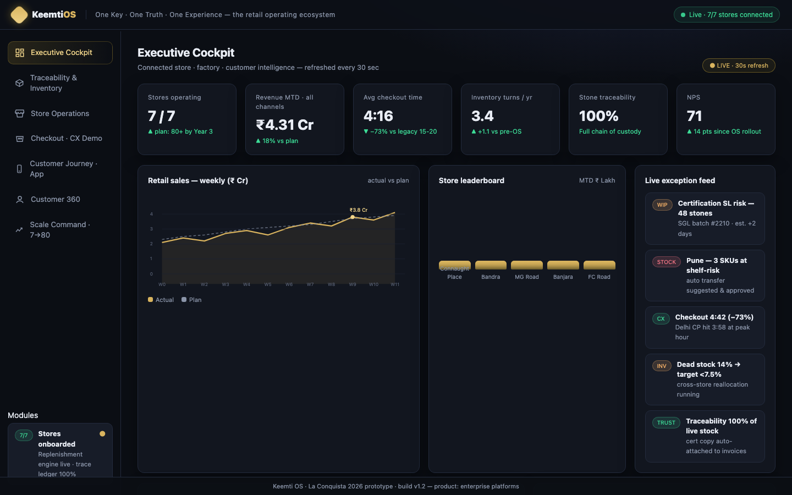

# Keemti OS

**One Key · One Truth · One Experience: the retail operating ecosystem for a 7 → 80 store scale-up.**

Interactive product prototype built for **La Conquista 2026: The Responsible Business Conquest** (SDA Bocconi Asia Center × Keemti), *Product Management · Enterprise Platforms* track. Prepared by team **ISBians**, Indian School of Business.

### 🔗 Live prototype: **[keemtios.vercel.app](https://keemtios.vercel.app)**  ·  📄 [Submission deck (PDF)](docs/KeemtiOS-LaConquista2026-Deck.pdf)



---

## The problem

Keemti, a lab-grown diamond jewellery brand, runs 7 stores and plans to grow to 80+. Its systems were not built for that scale:

| Priority | Fault line | Today |
|---|---|---|
| **P0** | **Disconnected backbone:** manufacturing and retail run on separate platforms | 2 siloed systems, 0% real-time sync |
| **P0** | **Inventory without truth:** about 1,200 SKUs per store pass through 7 unlinked stages | 14% dead stock, 2.3 inventory turns a year |
| **P1** | **Checkout is the bottleneck:** billing takes 15–20 minutes, with no clienteling | about 5.5 staff-hours lost per store per day |
| **P1** | **Leadership is flying blind:** there is no unified dashboard | reporting is manual only |

## The solution: seven modules on one integration spine

Every action publishes one event to a shared **integration spine**, and every module subscribes to it. The prototype shows each module as a screen:

| Module | What it shows |
|---|---|
| **Executive Cockpit** | Six live KPIs, weekly sales vs plan, store leaderboard, live exception feed, SKU and stone health, the factory and supply line, and the "Responsible Business" layer |
| **Traceability & Inventory** | A serial-level **Stone Twin** registry and chain of custody (factory → SGL certification → warehouse → store → customer). Also a **lifetime buyback** flow: verify the stone, value it at 87% of its last certified price, pay out by voucher or NEFT within 48 hours. |
| **Store Operations** | Store health scores, the AI **replenishment engine**, warehouse → store transfers, and an **AI decision log** where each decision is marked auto, review or override |
| **Checkout · CX Demo** | A clickable 3-step checkout simulator (scan & sell → price + certificate → confirm & invoice) with a running timer, plus clienteling suggestions drawn from purchase history |
| **Customer Journey · App** | The customer's app: the stone's journey, QR verification, instant buyback quote, concierge booking and a working DPDP consent toggle |
| **Customer 360** | Repeat rate, average order value, cross-sell, personas with triggered moments, and the NPS breakdown |
| **Scale Command · 7→80** | A network-size slider that recomputes run-rate, live stones, SKU-store cells, auto-replenishment, inventory turns and NPS from the pilot's economics |

## Target impact

| Metric | Today (7 stores) | Target (80 stores) |
|---|---|---|
| Run-rate | ₹35 Cr | **₹480 Cr** |
| Average checkout time | 15–20 min | **4:42** |
| Dead stock | 14% | **7.5%** |
| Inventory turns per year | 2.3× | **3.4×** |
| NPS | 57 | **71** |
| Stone traceability | – | **100%** |

## Roadmap

| Phase | Stores | Months | Ships |
|---|---|---|---|
| **0 · Stabilize** | 7 → 20 | 1–4 | Stone Twin, trace ledger, Integration Spine MVP, checkout pilot at 3 flagship stores |
| **1 · Connect** | 20 → 50 | 5–9 | Spine at every store, AI replenishment, buyback at scale, customer app |
| **2 · Optimize** | 50 → 80 | 10–15 | Predictive demand, dynamic pricing, company-wide executive MIS, DPDP audit |

Platform strategy: **Keep** the factory ERP and connect it through an API bridge. **Buy** store POS and hardware. **Build** the differentiated core: the Stone Twin, the integration spine, the cockpit and the app.

The full reasoning is in the [submission deck](docs/KeemtiOS-LaConquista2026-Deck.pdf).

## About the data

All stores, stones, customers, orders and metrics are **illustrative mock data** written for the case. The "live" feeds and timers are simulated in the browser. There is no backend and no real customer data.

## Tech

- One self-contained **`index.html`** (~67 KB): vanilla JavaScript, inline CSS and SVG charts
- No framework, no build step and no external requests

### Run locally

```bash
open index.html
```

## Deployment

This repo is connected to the Vercel project **`keemtios`**. Every push to `main` deploys to production at [keemtios.vercel.app](https://keemtios.vercel.app).

`vercel.json` turns on clean URLs. It also redirects the old paths (`/KeemtiOS-Prototype-LaConquista2026`, `/R1_ISBians_ISB.pdf`) to their new locations, so links shared earlier still work.

```
.
├── index.html                                # the whole prototype
├── vercel.json                               # clean URLs + legacy redirects
└── docs/
    ├── KeemtiOS-LaConquista2026-Deck.pdf     # 5-page submission deck
    └── screenshots/                          # images used in this README
```

## Disclaimer

This is a case-competition prototype. It is not an official Keemti product, and all figures are illustrative.
